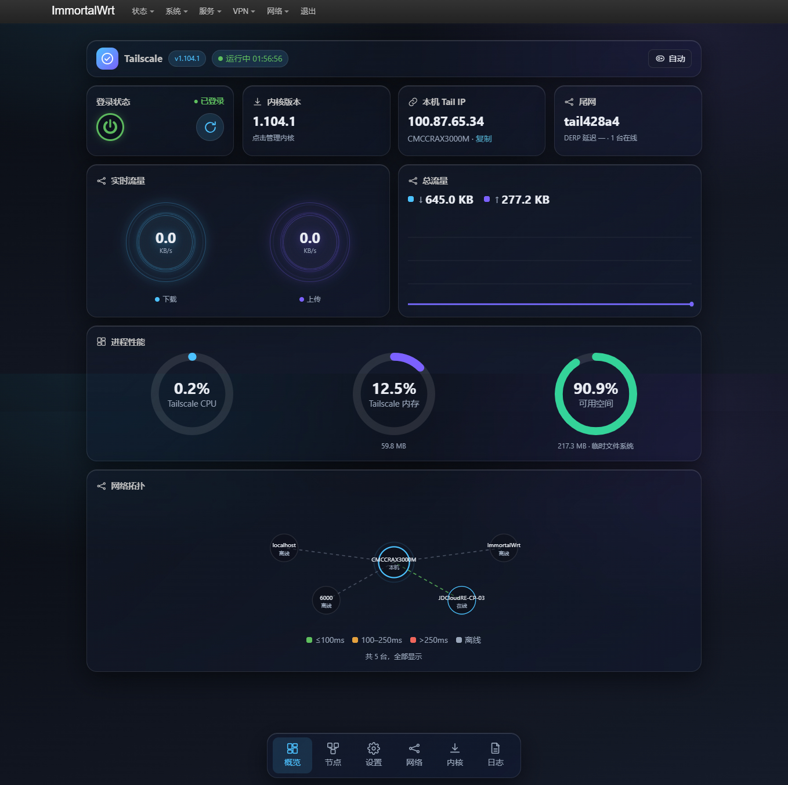
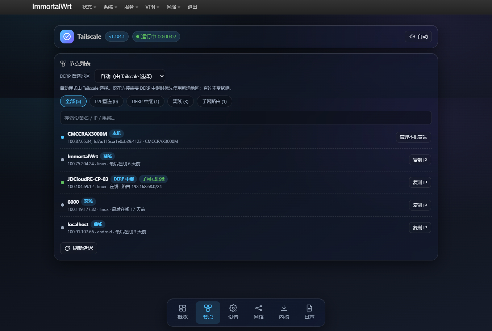
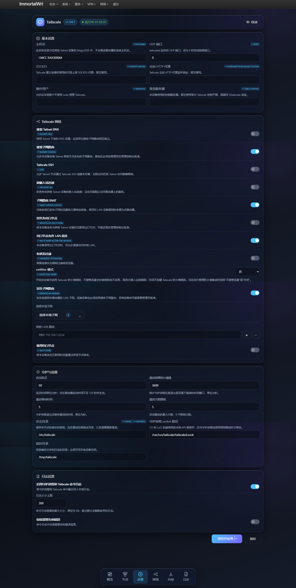
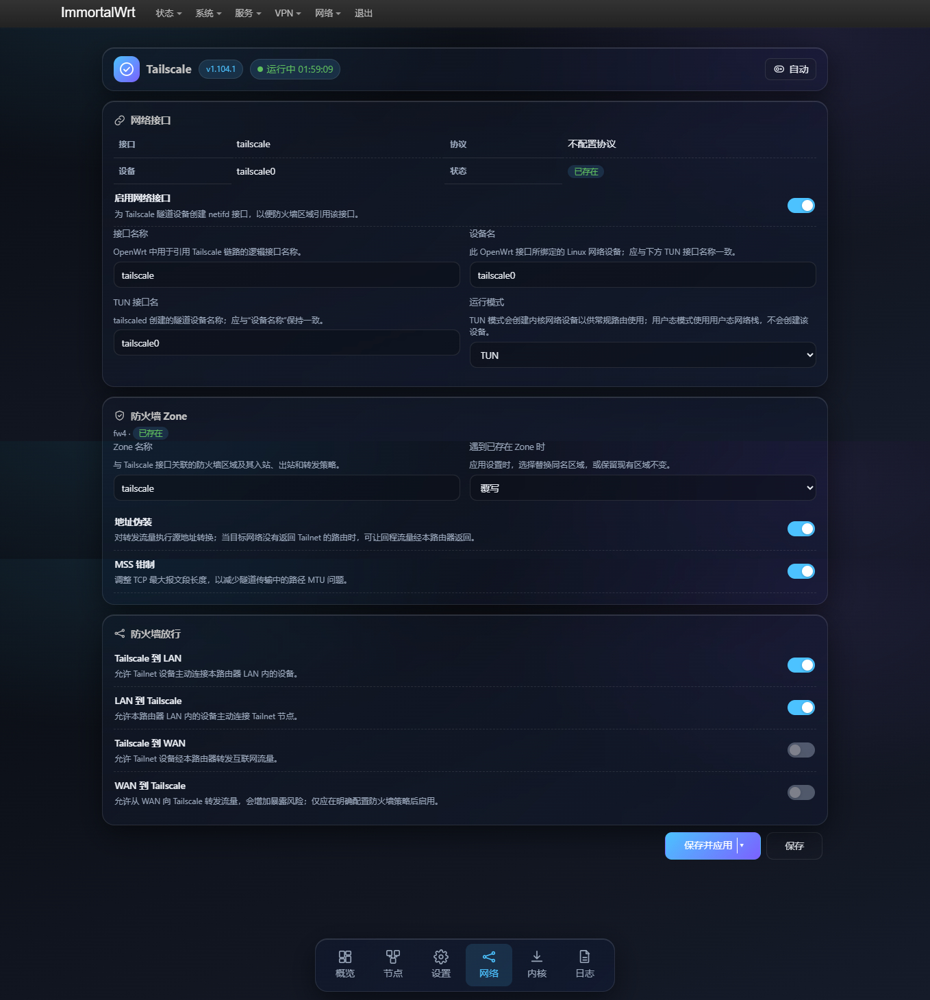
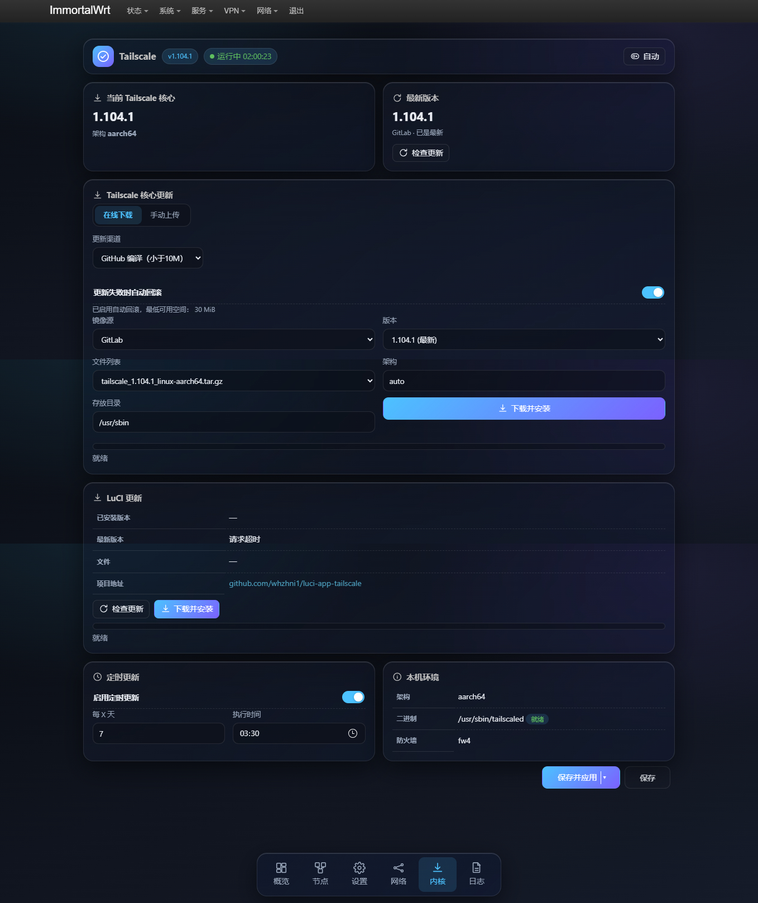

# luci-app-tailscale

[English](README.md) | 简体中文

`luci-app-tailscale` 是 OpenWrt 的 LuCI 管理界面，用于查看和管理 Tailscale 核心服务、节点、路由、OpenWrt 网络集成与更新。日常操作可在 LuCI 中完成，无需登录路由器逐条执行 Tailscale 命令。

## 环境要求

- **OpenWrt 版本**：OpenWrt 22.03 及以上。
- **主题支持**：跟随浏览器自动切换亮色/暗色主题。

## 📥 安装说明

### 自动安装（推荐）

终端执行以下命令
```bash
curl -fsSL "https://gitlab.com/whzhni/tailscale/-/raw/main/Auto_Install_Script.sh" | sh -s luci-app-tailscale
```

或：

```bash
wget -q -O - "https://gitlab.com/whzhni/tailscale/-/raw/main/Auto_Install_Script.sh" | sh -s luci-app-tailscale
```

### 手动安装

**APK (OpenWrt 25.12):**

```bash
apk add --allow-untrusted luci-app-tailscale.apk
apk add --allow-untrusted luci-i18n-tailscale-zh-cn-*.apk  # 中文
```

**IPK (OpenWrt 24.10):**

```bash
opkg install luci-app-tailscale.ipk
opkg install luci-i18n-tailscale-zh-cn_*_all.ipk  # 中文
```

## 运行方式

1. 安装 `luci-app-tailscale` 并在 LuCI 中打开。
2. 在 **核心** 页下载 Tailscale 内核。
3. 在 **概览** 页点击电源按钮启动服务。
4. 点击 **未登录** 进行登录，支持扫码、打开链接、AuthKey 三种方式登录。

> **推荐替代方案**：如果需要更强的穿透能力和更低的资源占用，推荐使用 [`whzhni1/luci-app-vnt2`](https://github.com/whzhni1/luci-app-vnt2)。

## 功能一览

### 1. 运行状态面板 (Overview)

查看服务与登录状态、Tailnet、Tailscale IP、当前版本、节点数量及 DERP 延迟；提供启动/停止、重启和登录操作。
- **流量与资源监控**：分别显示实时上传/下载速率和累计流量，并查看 Tailscale 进程的 CPU、内存及设备可用空间。
- **节点拓扑**：直观展示节点连接状态与延迟拓扑图。

### 2. 节点与拓扑 (Nodes)

浏览在线/离线节点，按直连、DERP 中继、子网路由等筛选，搜索节点，并查看延迟和拓扑关系。
- 可选择首选 DERP 区域。
- 管理我的路由、复制节点 IP。

### 3. Tailscale 网络设置 (Settings)

配置接受 DNS/子网路由、宣告本地及自定义 CIDR 子网、出口节点、Tailscale SSH、入站限制、SNAT、Netfilter 模式和自定义控制服务器等。
- **Guard and advanced**：配置服务启动延迟、异常重启、状态目录、临时目录。
- **日志设置**：开启或关闭守护进程与 Tailscale 命令日志，设置日志大小上限，并支持仅保留警告和错误。

### 4. OpenWrt 网络集成 (Network)

在 TUN 与 userspace 模式间选择；配置 Tailscale 网络接口、防火墙 zone、masquerading、MSS 调整，以及 Tailscale、LAN、WAN 之间的转发。
- **防火墙转发**：配置 Tailscale 到 LAN、LAN 到 Tailscale、Tailscale 到 WAN、WAN 到 Tailscale 的转发规则。

### 5. Tailscale 核心更新 (Core)

更新页中的 **Tailscale core update** 管理的是 Tailscale 核心二进制（`tailscaled` / `tailscale`），不是 OpenWrt 的架构专用软件包。在线更新会按设备架构匹配对应的 Linux 构建产物，并直接下载、验证和安装核心程序；**无需另外安装对应架构的 Tailscale OpenWrt 软件包**。

## 更新指南

### 默认推荐：自编译渠道
默认渠道是界面显示的 **“GitHub 编译（小于10M）”**。该渠道获取自编译核心构建，默认镜像顺序为 **GitLab → Cloudflare R2 → GitHub**，也可在更新页选择可用来源、版本、归档文件和架构。GitHub 项目为 [`whzhni1/tailscale`](https://github.com/whzhni1/tailscale)。

下载器会取得匹配设备架构的归档，校验 SHA-256，抽取核心二进制并进行运行检查后再安装。启用自动回滚时会先备份现有核心；安装失败时尝试恢复并重启服务。

### 官方渠道
官方渠道调用设备上 Tailscale 自带的原生 `tailscale update --yes` 更新流程，不走自编译渠道的镜像归档下载器。官方静态二进制安装后约占 **70 MiB**；下载、临时文件和可选回滚备份还会增加更新时的空间需求。**闪存较小的 OpenWrt 设备不推荐选择官方渠道，通常优先使用默认自编译渠道。**

### 空间不足时的处理
更新前会检查安装目录和临时目录所在文件系统的可用空间；官方渠道还会检查下载缓存所在文件系统。下表是启用/关闭自动回滚时要求的最低可用空间门槛：

| 更新渠道 | 自动回滚开启 | 自动回滚关闭 |
|---|---:|---:|
| 自编译 | 30 MiB | 10 MiB |
| 官方 | 200 MiB | 130 MiB |

这些数值要求适用于相关文件系统，**不是多个分区空间相加后的总量**。可用空间不足或无法确认时，页面会禁用不满足门槛的渠道/下载操作，并提示自动更新或回滚不可用；后端也会拒绝不满足空间条件的更新任务。关闭自动回滚虽可降低空间门槛，但更新失败时不会恢复旧核心。

### 手动上传
更新页也支持手动安装：从产物页获取并解压对应设备架构的构建，只选择解压后的 `tailscaled` 文件上传。文件会先暂存在 RAM 中，通过检查后才替换已安装的核心并重启服务。上传文件上限为 **32 MiB**，同时需要足够的 RAM 临时空间。

手动安装过程中服务会重启。请尽量从路由器 **LAN 地址**打开管理页面；若仅通过 Tailscale 连接，重启时连接会中断。手动上传不会更改在线更新渠道。页面提供 GitHub、GitLab 产物页；自编译渠道还可解析匹配当前设备的直链。

## LuCI 应用更新与计划更新

更新页将 **Tailscale 核心更新**与 **LuCI 应用更新**分开显示：前者更新 `tailscaled` / `tailscale`，后者更新 `luci-app-tailscale` 软件包。更新 LuCI 应用使用 OpenWrt 的软件包管理器（`opkg` 或 `apk`），不要把它与核心二进制更新混为一谈。

计划更新默认关闭。开启后可设置执行间隔和时间；计划任务按当前更新渠道和回滚设置检查相同的空间要求。未固定核心版本/归档时，计划更新流程也会检查并更新 LuCI 应用。

## 子网路由提示

在设置页可从设备当前 LAN 候选网段中多选，也可添加自定义 CIDR。宣告路由后，通常还需要在 Tailscale 管理控制台批准路由；其他设备也需开启接受子网路由，才能通过该路由访问 LAN。

## 项目地址

- LuCI 管理界面：[`whzhni1/luci-app-tailscale`](https://github.com/whzhni1/luci-app-tailscale)
- Tailscale 自编译核心与产物：[`whzhni1/tailscale`](https://github.com/whzhni1/tailscale)
- GitLab 核心产物：[`whzhni/tailscale` releases](https://gitlab.com/whzhni/tailscale/-/releases)