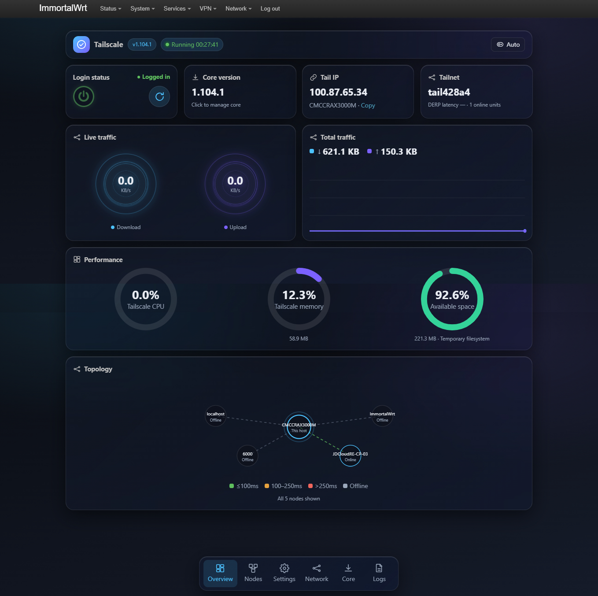
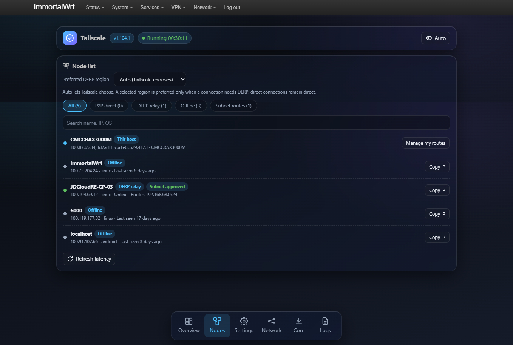
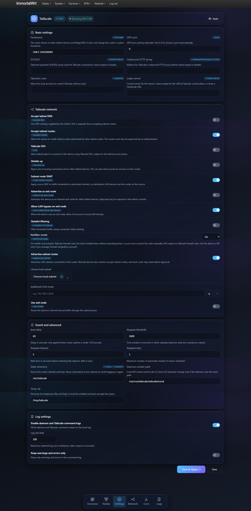
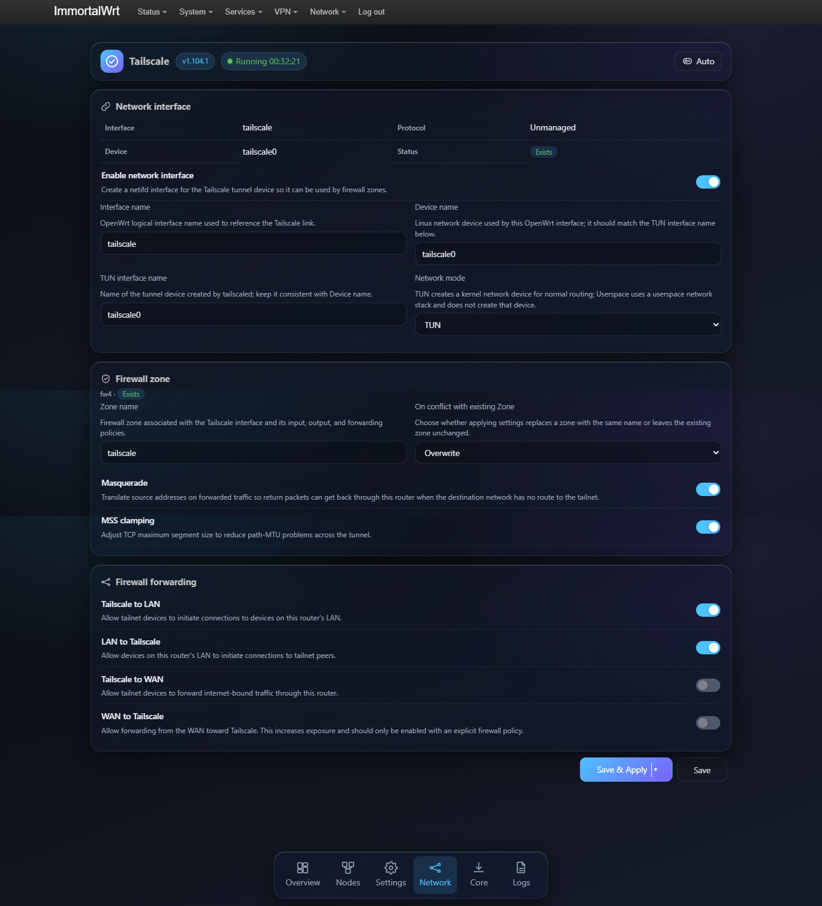
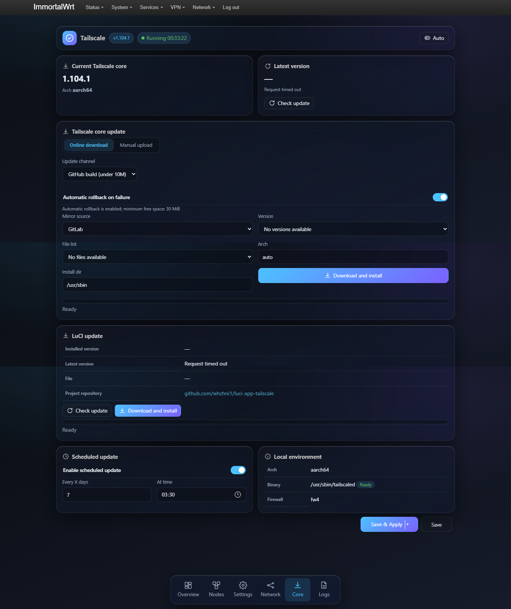

# luci-app-tailscale

English | [简体中文](CN_README.md)

`luci-app-tailscale` is a LuCI management interface for OpenWrt, designed to view and manage the Tailscale core service, nodes, routing, OpenWrt network integration, and updates. Daily operations can be completed directly within LuCI without the need to log into the router and execute Tailscale commands line by line.

## Requirements

- **OpenWrt Version**: OpenWrt 22.03 or later.
- **Theme Support**: Automatically follows browser settings for light/dark mode.

## Installation

### Automatic Installation (Recommended)

Run the following command in the terminal

```bash
curl -fsSL "https://gitlab.com/whzhni/tailscale/-/raw/main/Auto_Install_Script.sh" | sh -s luci-app-tailscale
```

Or:

```bash
wget -q -O - "https://gitlab.com/whzhni/tailscale/-/raw/main/Auto_Install_Script.sh" | sh -s luci-app-tailscale
```

### Manual Installation

**APK (OpenWrt 25.12):**

```bash
apk add --allow-untrusted luci-app-tailscale.apk
apk add --allow-untrusted luci-i18n-tailscale-zh-cn-*.apk  # Chinese
```

**IPK (OpenWrt 24.10):**

```bash
opkg install luci-app-tailscale.ipk
opkg install luci-i18n-tailscale-zh-cn_*_all.ipk  # Chinese
```

## Quick Start

1. Install `luci-app-tailscale` and open it in LuCI.
2. Download the Tailscale core on the **Core** page.
3. On the **Overview** page, click the power button to start the service.
4. Click **Not logged in** to log in. QR code, open link, and AuthKey login are supported.

> **Alternative Recommendation**: If you need stronger NAT traversal and lower resource usage, try [`whzhni1/luci-app-vnt2`](https://github.com/whzhni1/luci-app-vnt2).

## Features

### 1. Overview Dashboard

View service and login status, Tailnet, Tailscale IP, current version, node count, and DERP latency. Provides start/stop, restart, and login operations.
- **Live Traffic & Resource Monitoring**: Displays real-time upload/download speeds, cumulative traffic, Tailscale process CPU, memory usage, and available device storage.
- **Topology**: Visualizes node connection status and latency topology.

### 2. Nodes & Topology

Browse online/offline nodes, filter by direct connection, DERP relay, or subnet routes, search for nodes, and view latency and topology relationships.
- Select preferred DERP region.
- Manage routes and copy IP addresses for specific nodes.

### 3. Tailscale Network Settings

Configure Accept DNS/Subnet routes, advertise local and custom CIDR subnets, exit nodes, Tailscale SSH, inbound restrictions, SNAT, Netfilter mode, and custom control servers.
- **Guard and Advanced**: Configure boot delay, respawn threshold, state directory, and temp directory.
- **Log Settings**: Enable/disable daemon and Tailscale command logs, set log size limit, and keep only warnings and errors.

### 4. OpenWrt Network Integration

Choose between TUN and userspace modes; configure Tailscale network interface, firewall zone, masquerading, MSS adjustment, and forwarding between Tailscale, LAN, and WAN.
- **Firewall Forwarding**: Configure Tailscale to LAN, LAN to Tailscale, Tailscale to WAN, and WAN to Tailscale forwarding rules.

### 5. Tailscale Core Update

The **Tailscale core update** in the update page manages the Tailscale core binaries (`tailscaled` / `tailscale`), not the OpenWrt architecture-specific software package. Online updates will match the corresponding Linux build artifacts based on the device architecture and directly download, verify, and install the core program. **There is no need to install the corresponding architecture's Tailscale OpenWrt software package separately.**

## Update Guide

### Default Recommended: Self-compiled Channel
The default channel is **"GitHub Build (less than 10M)"** as shown in the interface. This channel fetches self-compiled core builds with a default mirror order of **GitLab → Cloudflare R2 → GitHub**. You can also select available sources, versions, archive files, and architectures on the update page. The GitHub project is [`whzhni1/tailscale`](https://github.com/whzhni1/tailscale).

The downloader will fetch the archive matching the device architecture, verify the SHA-256, extract the core binary, and perform a runtime check before installation. When automatic rollback is enabled, the existing core will be backed up first; if installation fails, it will attempt to restore and restart the service.

### Official Channel
The official channel calls the native `tailscale update --yes` update process built into the device, without going through the self-compiled channel's mirror archive downloader. The official static binary takes up about **70 MiB** after installation. Downloading, temporary files, and optional rollback backups will also increase the space requirements during updates. **OpenWrt devices with small flash storage are not recommended to choose the official channel; usually, the default self-compiled channel is preferred.**

### Handling Insufficient Space
Before updating, the available space of the filesystem where the installation directory and temporary directory are located will be checked; the official channel also checks the filesystem where the download cache is located. The following table shows the minimum available space thresholds required when automatic rollback is enabled/disabled:

| Update Channel | Auto Rollback ON | Auto Rollback OFF |
|---|---:|---:|
| Self-compiled | 30 MiB | 10 MiB |
| Official | 200 MiB | 130 MiB |

These values apply to the relevant filesystems and **are not the total after adding multiple partitions**. If space is insufficient or cannot be confirmed, the page will disable channels/download operations that do not meet the threshold and prompt that automatic updates or rollbacks are unavailable; the backend will also reject update tasks that do not meet the space conditions. Although turning off automatic rollback reduces the space threshold, it will not restore the old core if the update fails.

### Manual Upload
The update page also supports manual installation: obtain and extract the build corresponding to the device architecture from the artifact page, and select only the extracted `tailscaled` file for upload. The file will be temporarily stored in RAM and, after passing checks, will replace the installed core and restart the service. The upload file limit is **32 MiB**, and sufficient RAM temporary space is required.

During the manual installation process, the service will restart. Please try to open the management page from the router's **LAN address**; if connected only via Tailscale, the connection will be interrupted during the restart. Manual upload will not change the online update channel. The page provides links to GitHub and GitLab artifact pages; the self-compiled channel can also resolve direct links matching the current device.

## LuCI App Update & Scheduled Update

The update page separates **Tailscale Core Update** and **LuCI App Update**: the former updates `tailscaled` / `tailscale`, and the latter updates the `luci-app-tailscale` software package. Updating the LuCI app uses OpenWrt's package manager (`opkg` or `apk`), and do not confuse it with the core binary update.

Scheduled updates are disabled by default. Once enabled, you can set the execution interval and time; scheduled tasks check the same space requirements according to the current update channel and rollback settings. When the core version/archive is not pinned, the scheduled update process will also check and update the LuCI app.

## Subnet Routing Tips

On the settings page, you can multi-select from the device's current LAN candidate subnets or add custom CIDR. After advertising routes, they usually need to be approved in the Tailscale admin console; other devices also need to enable accepting subnet routes to access the LAN through this route.

## Project Links

- LuCI Management Interface: [`whzhni1/luci-app-tailscale`](https://github.com/whzhni1/luci-app-tailscale)
- Tailscale Self-compiled Core & Artifacts: [`whzhni1/tailscale`](https://github.com/whzhni1/tailscale)
- GitLab Core Artifacts: [`whzhni/tailscale` releases](https://gitlab.com/whzhni/tailscale/-/releases)